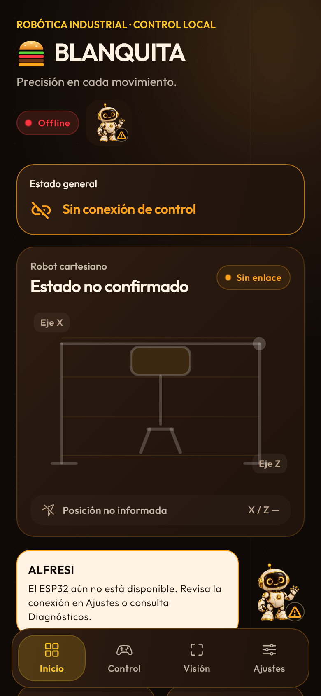
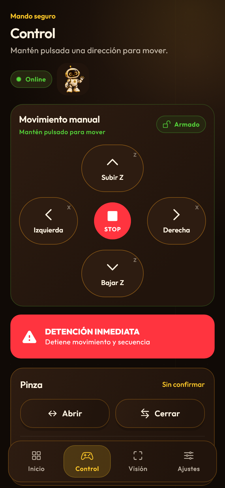
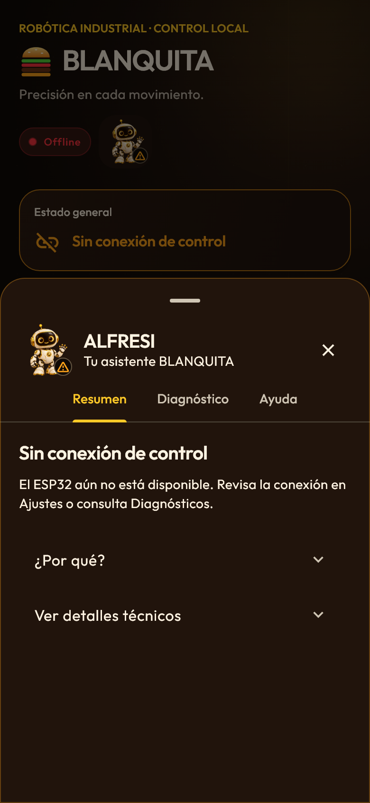

# Capturas reales de Flutter

Renderizadas a 390×844 px lógicos y resolución 2× con `flutter test`. No son mockups generativos. Las capturas de conexión confirmada usan controladores reales y dobles de transporte en pruebas; no acreditan conexión física con el robot.

| Evidencia | Archivo |
| --- | --- |
| Inicio Original | [01-inicio-original.png](01-inicio-original.png) |
| Inicio Hamburguesa | [02-inicio-hamburguesa.png](02-inicio-hamburguesa.png) |
| Control Hamburguesa | [03-control-hamburguesa.png](03-control-hamburguesa.png) |
| Visión Hamburguesa | [04-vision-hamburguesa.png](04-vision-hamburguesa.png) |
| Ajustes Hamburguesa | [05-ajustes-hamburguesa.png](05-ajustes-hamburguesa.png) |
| Diagnósticos Hamburguesa | [06-diagnosticos-hamburguesa.png](06-diagnosticos-hamburguesa.png) |
| Modal éxito | [07-modal-exito.png](07-modal-exito.png) |
| Modal error | [08-modal-error.png](08-modal-error.png) |
| Modal proceso | [09-modal-proceso.png](09-modal-proceso.png) |
| Bloqueo manual | [10-bloqueo.png](10-bloqueo.png) |
| Selector de tema | [11-selector-tema.png](11-selector-tema.png) |
| ALFRESI cerrado | [12-alfresi-cerrado.png](12-alfresi-cerrado.png) |
| ALFRESI abierto | [13-alfresi-abierto.png](13-alfresi-abierto.png) |
| Diagnósticos / Logs | [14-diagnosticos-logs.png](14-diagnosticos-logs.png) |
| Modal tras pulsar la prueba pública de conexión existente | [15-modal-prueba-conexion.png](15-modal-prueba-conexion.png) |

## Responsive

En todos los casos se recorrieron Inicio, Control, Visión y Ajustes y se abrió Diagnósticos. Las imágenes muestran el final del recorrido en Ajustes. La prueba usa además texto Grande y densidad Grande; una escala de sistema del 200 % se combina con la preferencia personal, sin suprimirla.

| Vista lógica | Sistema 100 % | Sistema 200 % |
| --- | --- | --- |
| 360×800 | [Captura](responsive-360-800-100.png) | [Captura](responsive-360-800-200.png) |
| 390×844 | [Captura](responsive-390-844-100.png) | [Captura](responsive-390-844-200.png) |
| 412×915 | [Captura](responsive-412-915-100.png) | [Captura](responsive-412-915-200.png) |
| 800×1024 | [Captura](responsive-800-1024-100.png) | [Captura](responsive-800-1024-200.png) |
| 844×390 horizontal | [Captura](responsive-844-390-100.png) | [Captura](responsive-844-390-200.png) |

## Vistas principales







## Reproducción

```powershell
flutter test test/frontend_evidence_test.dart --dart-define=GENERAR_EVIDENCIAS=true
```

El archivo de pruebas renderiza los widgets implementados, carga las fuentes locales y exporta los PNG. La mascota premium es un asset ilustrado local, descrito en el [reporte](../../REDISENO-HAMBURGUESA-ALFRESI.md); las pantallas completas se capturan con Flutter.
