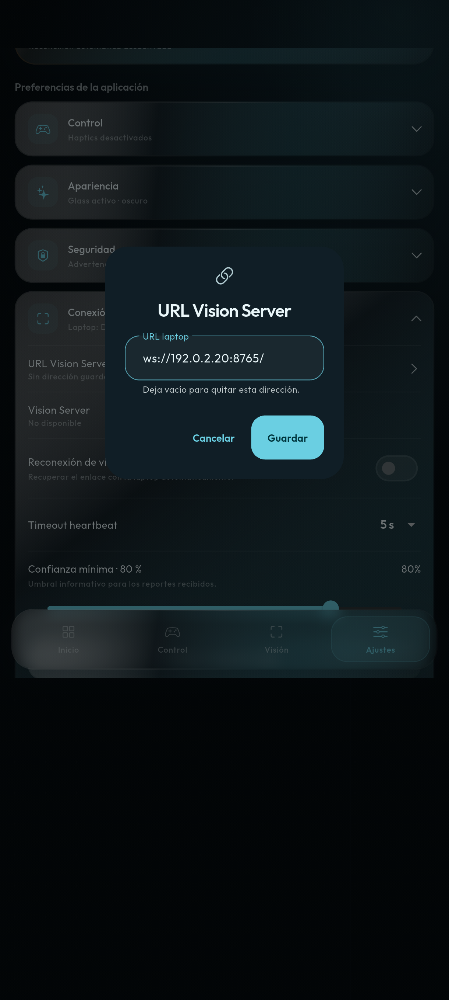
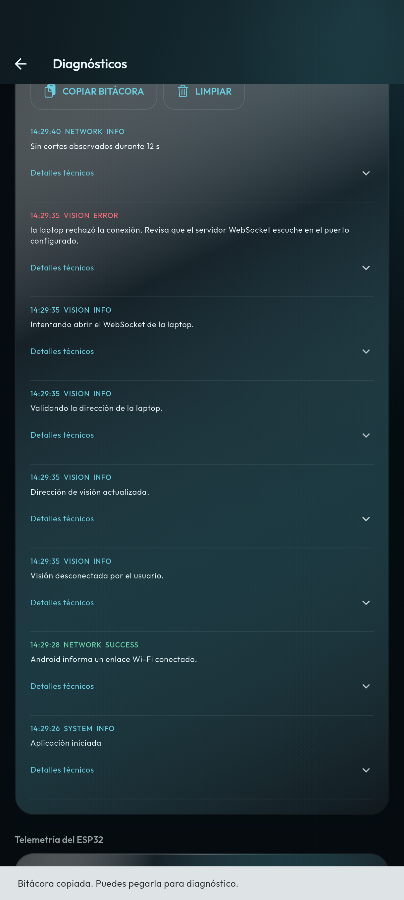
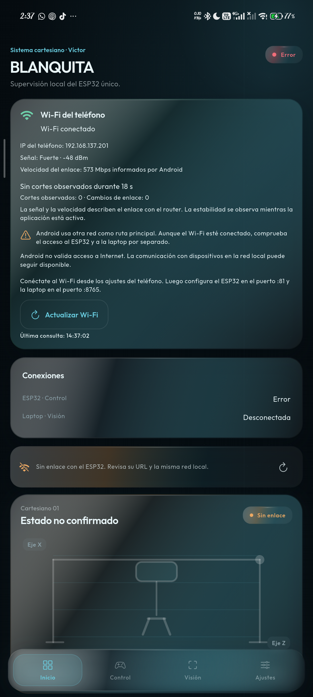

# BLANQUITA Víctor — entrega de conexión y diagnóstico

Fecha: 6 de octubre de 2026 (America/La_Paz).

## Rama

`feature/victor`, creada desde `feat/vision-client` actualizado por avance rápido.
Base verificada: `70d01b7`. Cambios locales, sin publicación remota.

## Aplicación independiente

Nombre Android: **BLANQUITA Víctor**. Identificador: `com.example.blanquita.victor`.
Puede coexistir con `com.example.blanquita`; sus preferencias son independientes.
En una instalación nueva los endpoints empiezan vacíos. La primera prueba del
formulario usó preferencias y transportes aislados; después se probaron las URLs
reales aportadas por el usuario, con resultados separados en este informe.

## Arquitectura resultante

```text
Router/hotspot = conectividad IP local
Móvil → ws://IP_ESP32:81/   → control físico, confirmado con READY
Móvil → ws://IP_LAPTOP:8765/ → visión, confirmada con vision.ready
```

Los puertos son editables. El log posterior aportado del Vision Server indica
8765, que reemplaza el puerto 6580 indicado durante la entrega anterior.
Control y visión tienen estados, sesiones, configuración y reconexión separados.
La percepción de la laptop no envía movimientos al ESP32. Internet no es requisito.
No hay descubrimiento UDP, broadcast, escaneo de IP ni lectura/escaneo de SSID.
CARTESIANO se muestra como red esperada, sin afirmar una detección.

### Ampliación posterior: Wi-Fi real del teléfono

Por petición posterior se añade lectura de conectividad Wi-Fi Android antes de los
endpoints: conexión, IPv4, señal RSSI, velocidad del enlace, ruta predeterminada e
Internet validado cuando están disponibles. La continuidad y los cortes describen
la ventana observada en primer plano; no garantizan estabilidad futura ni acceso a
ESP32/laptop. No se lee ni escanea SSID y CARTESIANO sigue siendo una referencia.

La lectura usa `ACCESS_NETWORK_STATE` y `ACCESS_WIFI_STATE` normales; no añade
ubicación/Nearby ni cambia las redes del teléfono o el transporte de control.
Diagnósticos añade la instantánea Wi-Fi a APP al copiar bitácora, manteniendo dos
endpoints separados. Ver [detección Wi-Fi y límites](deteccion-wifi.md).
Las validaciones y el SHA de la entrega anterior se conservan como antecedentes.
La validación y el APK actuales de esta ampliación se detallan al final del informe.

### Datos de servidores recibidos después

El log serial del ESP32 informa IP `192.168.137.209`, WebSocket 81 y
`ROLE:SENSORES`, con telemetría de plato/final/snapshot. Permite proponer
`ws://192.168.137.209:81/`, pero el mensaje serial “SISTEMA LISTO” no confirma que
el servidor envíe `READY` por WebSocket ni que ese firmware de sensores implemente
el rol de control físico esperado. La comprobación de transporte/protocolo real
debe conservarse separada de esta evidencia serial.

El log de laptop indica bind `0.0.0.0:8765`; posteriormente se aportó la IP LAN
`192.168.137.27` para `ws://192.168.137.27:8765/`. No configurar `0.0.0.0` como destino del teléfono.
El anuncio UDP del servidor no se utiliza; la app mantiene conexión directa a la
URL configurada. Las comprobaciones desde el móvil de `READY` y `vision.ready`
siguen pendientes de evidencia actual. No se autoriza control por un log serial.

### Primera prueba posterior con endpoints reales

**PASÓ LA LECTURA WI-FI, FALLÓ EL ALCANCE A SERVIDORES.** El teléfono informó
`192.168.137.201`, RSSI -48 dBm, enlace 573 Mbps, 0 cortes y 0 cambios observados
(31 s iniciales, 36 s en repetición). Android usaba otra ruta predeterminada y no
validaba Internet en Wi-Fi. Ambos WebSockets terminaron en timeout sin RX/TX de
aplicación: ESP32 en 5000 ms y laptop en 8000 ms.

La comprobación TCP específica mediante la red Wi-Fi falló también en ambos con
`EHOSTUNREACH (No route to host)`, en unos 2300 ms desde la IP Wi-Fi del teléfono.
No se concluye que forzar la ruta del proceso arregle el problema; también falló
la ruta Wi-Fi explícita. La IP/red actuales de cada equipo y el aislamiento del
punto de acceso son comprobaciones posibles, sin atribuir una causa definitiva.
Ver [datos y error original de la prueba real](prueba-conexiones-reales.md).

Diagnósticos incorpora **Verificar puerto por Wi-Fi** en ambos endpoints para
repetir el alcance TCP sin comandos físicos. La bitácora NETWORK conserva sus
resultados. `READY`, `vision.ready` y funcionamiento físico no fueron confirmados.

### Repetición actual con ESP32 encendido

El usuario confirmó el ESP32 encendido y autorizó volver a comprobar
`ws://192.168.137.209:81/`. La repetición de 14:25:08–14:25:45 conservó Wi-Fi
conectado en `192.168.137.201`, señal -48 dBm, enlace 573 Mbps y 36 s sin cortes
ni cambios observados; ruta predeterminada Wi-Fi e Internet validado fueron false.

ESP32 volvió a dar timeout WebSocket de 5000 ms y `HOST_UNREACHABLE` por TCP
dirigido por Wi-Fi, con `EHOSTUNREACH` en 2326 ms. La laptop dio timeout WebSocket
de 8000 ms y timeout TCP dirigido por Wi-Fi de 3008 ms. En ambos canales RX/TX de
aplicación quedaron vacíos; no se confirmaron READY/vision.ready ni se enviaron
comandos físicos. No se atribuye el fallo a equipo apagado: el encendido fue
confirmado por el usuario, pero el alcance sigue sin resolverse.

El resultado actual y los errores originales están en
[prueba real desde el teléfono](prueba-conexiones-reales.md), con JSON y bitácora
de la repetición. El error Wi-Fi específico también falló; no se implementó un
cambio global de ruta como supuesto arreglo. Sigue pendiente contrastar las IP
actuales, LAN y comunicación permitida entre clientes del punto de acceso.

Una comprobación adicional ICMP por `wlan0` al ESP32 envió 2 paquetes sin recibir
respuestas y obtuvo 2 errores de destino no alcanzable; su entrada vecina en
`wlan0` estaba `FAILED`. Se confirma el fallo de alcance LAN observado, sin inferir
una causa única. Está pendiente el serial actual posterior al encendido, con red e
IP, para contrastar la dirección real del ESP32.

## Flujo ESP32

1. Cargar `connection.websocket_url` y validarla (esquema, host, puerto, sin credenciales/fragmento).
2. Abrir transporte con timeout propio de 5 segundos.
3. Registrar WebSocket abierto y comenzar espera READY, con otros 5 segundos.
4. Sólo READY recibido más transporte abierto permiten control físico.
5. Una pérdida cancela movimiento, heartbeat y sesión, e invalida sensores de esa sesión.
6. Reintentar la URL guardada en 2, 4, 8 y 15 segundos, con máximo 15 segundos entre intentos.
7. Desconectar manualmente cancela reintentos. Cambiar URL invalida la sesión anterior.

Se conserva `a/d/w/s`, STOP `x`, heartbeat `k` cada 200 ms durante movimiento,
pinza `q/e`, secuencia `j`, emergencia `z` y velocidad `+/-`.
STOP al soltar/desmontar el control, final de carrera y bloqueo sin READY permanecen activos.
En segundo plano se detiene el movimiento y se bloquean controles; visión cierra su sesión.
Una URL cambiada explícitamente en segundo plano conecta al volver, incluso con reintentos automáticos desactivados.

## Flujo visión

1. Cargar y validar `vision.websocket_url` por separado.
2. Abrir WebSocket de laptop (timeout de transporte de 8 segundos por defecto).
3. Mostrar transporte abierto y esperar `vision.ready`, con timeout independiente de 8 segundos.
4. `vision.status` y `vision.heartbeat` no sustituyen `vision.ready`.
5. Tras READY, comprobar heartbeat, telemetría, reportes, antigüedad y latencia.
6. Heartbeat vencido indica datos no vigentes; su plazo empieza tras confirmar protocolo.
7. Reintentar sólo visión con 1, 2, 4, 8, 16 y 30 segundos. Una desconexión manual cancela sus reintentos.

## Errores encontrados y corrección

| Problema | Causa encontrada | Corrección |
| --- | --- | --- |
| Fallos diferentes acababan como ESP32 no encontrado | Fallback de discovery sustituía el error de WebSocket | Eliminar el fallback y registrar fase, código y excepción original |
| Socket abierto y protocolo se confundían | Transporte y handshake compartían timeout/estado | Temporizadores y fases separados; control sólo tras READY |
| Visión podía aparentar ready sin mensaje esperado | Indicadores ready en otros mensajes sustituían handshake | Confirmar únicamente vision.ready válido |
| Recursos del formulario se liberaban durante cierre | dispose inmediato en control y espera fija en visión | EndpointDialog Stateful dueño de controlador/Form; dispose al desmontar ruta |
| Assertion al desmontar mando en movimiento | HoldToMoveButton.dispose notificaba durante árbol bloqueado; se reprodujo el stack | STOP inmediato y notificación diferida con protección de dispose |
| Guardar/Enter podía cerrar más de una ruta | No había protección contra envío repetido | Guard de envío único y botones desactivados durante salida |
| Aviso de URL inválida persistía al corregirla | Validación sólo al submit | Revalidar durante edición después del primer fallo de validación |
| Diagnóstico podía notificar durante un error de build | Logger notificaba síncronamente desde FlutterError | Entrada inmediata, notificación por microtask y guard de reentrada |
| Ajustes podían competir en almacenamiento | Guardados de snapshots independientes en paralelo | Serializar guardados y notificar después de persistir, sólo el snapshot vigente |
| Sesiones/telemetría antiguas podían confundirse con nuevas | Transiciones de URL/reconexión y estado histórico | Guardas de generación, sesión independiente e invalidación de sensores |
| Heartbeat se contaba antes de confirmar protocolo | Baseline desde apertura de transporte | Empezar comprobación tras vision.ready |

La imagen `_dependents.isEmpty` corresponde a un fallo del árbol Flutter. Su assertion
exacta no se reprodujo antes de la corrección; no se atribuye una causa definitiva a
partir de la imagen. Los problemas de ciclo de vida descritos sí se corrigieron y el
flujo de escritura/guardado se ejecutó en el teléfono sin excepciones de widgets.

## Bitácora

Abrir **Ajustes → Abrir diagnósticos → Bitácora de conexión**.
Dos tarjetas muestran estado, endpoint, IP/host, puerto, fase, transporte, protocolo,
últimos RX/TX, recepción, reintentos y último error. Los errores tienen explicación
humana y detalle técnico desplegable.

**COPIAR BITÁCORA** coloca APP/CONTROL/VISION/EVENTS en el portapapeles para pegar
el diagnóstico. **LIMPIAR** limpia historial sin cambiar endpoints ni conexiones.
Se conservan hasta 240 entradas en memoria. Ping/heartbeat/report de visión se
muestrean cada 10 segundos; el procesamiento de mensajes continúa a su frecuencia
original. El heartbeat físico k no produce spam. Se redactan credenciales,
fragmentos y query de URLs antes de registrar/exportar.

Hay códigos diferenciados para INVALID_ENDPOINT, CONNECT_TIMEOUT,
CONNECTION_REFUSED, HOST_UNREACHABLE, HOST_LOOKUP_FAILED, HANDSHAKE_FAILED,
READY_TIMEOUT, REMOTE_CLOSED, HEARTBEAT_TIMEOUT y errores de protocolo de visión.
Una IP incorrecta, un equipo apagado o aislamiento del router pueden dar el mismo
síntoma de timeout: la interfaz los presenta como posibles causas, sin inventar cuál.

## Skills y subagentes

Se aplicaron engineering:debug, ui-ux-pro-max, OpenAI Docs y engineering:documentation.
Tres subagentes trabajaron en archivos distintos: formularios/seguridad del mando,
protocolo de visión, y diagnósticos/documentación. El agente principal integró,
revisó y ejecutó la validación del dispositivo.
Los subagentes son agentes con contexto propio a los que se delegan tareas acotadas;
la coordinación combina sus resultados y evita editar los mismos archivos a la vez.
[Documentación oficial de subagentes](https://developers.openai.com/api/docs/guides/agents-api/multi-agent).

## Validación automatizada de la entrega previa a Wi-Fi

- `dart format .`: ejecutado con éxito apartando y restaurando temporalmente build; las rutas largas de artefactos Gradle causaban PathNotFoundException al recorrerlas. Las 47 fuentes también pasan formato dirigido.
- `flutter analyze --no-pub`: **No issues found**, exit 0.
- `flutter test --no-pub`: **86 pruebas pasan**, exit 0.
- `flutter build apk --debug --no-pub --target lib/main.dart`: **APK compilado**, exit 0; instalado y abierto como BLANQUITA Víctor.
- Búsqueda global de símbolos del discovery retirado: cero referencias en código, tests, README y documentación activa.
- `git diff --check`: sin errores de whitespace.

Pruebas incluyen endpoints inválidos, transporte, READY, timeouts separados, cierre
remoto/manual, reconexión/cancelación, URL cambiada, lifecycle, heartbeat, final de
carrera, independencia de ambos canales, formularios repetidos, teclado, paisaje,
texto al 200%, doble submit y notificación del logger durante build.

El SDK real de esa entrega es Flutter 3.47.6 / Dart 3.13.5. Android compile/target SDK 36, INTERNET
y cleartext ws local. En la entrega inicial no se agregaron permisos de Wi-Fi,
Nearby o ubicación; la ampliación posterior usa los dos permisos normales de
observación descritos arriba, sin Nearby ni ubicación.
El formateo global se recuperó apartando solamente artefactos generados, sin borrar fuentes.
Flutter actualizó sus exclusiones estándar de directorios generados/plataformas.

## Prueba en teléfono de la entrega previa a Wi-Fi

**PROBADO EN TELÉFONO:** modelo 24115RA8EG (dispositivo original conectado).
La regresión pasó con escritura de URL, error humano por esquema inválido,
corrección, guardar/cancelar repetidos, independencia de URLs, entrada a
Diagnósticos y lectura de la bitácora copiada al clipboard.

Comando reproducible:

```sh
flutter drive --driver=test_driver/diagnosticos_dispositivo.dart --target=integration_test/diagnosticos_dispositivo_test.dart -d ID_DEL_TELEFONO --no-pub --keep-app-running
```

Se usaron preferencias y canales simulados; ningún comando físico se transmitió.
El driver conserva capturas en `.dart_tool/phone-validation`. Al terminar una
prueba se debe instalar el APK normal (`lib/main.dart`), porque el APK de pruebas
no es la app de uso diario. `flutter test -d` puede retirar el APK de prueba al terminar;
para capturas se usa el driver indicado. La instalación final restaura la app normal.





**PENDIENTE DE PRUEBA EN HARDWARE COMPLETO:** router/hotspot + teléfono + ESP32 +
laptop real. En la entrega inicial faltaban las IP. Posteriormente se recibió la
IP serial candidata del ESP32 y la IP de laptop `192.168.137.27`. Ambas se probaron
desde el teléfono y falló el alcance. No se
validaron en esa entrega firmware, READY
real, vision.ready real, comunicación LAN física ni motores. El checklist está en
[network-architecture.md](network-architecture.md).

## Archivos modificados o creados

- `.gitignore`
- `README.md`
- `analysis_options.yaml`
- `android/app/build.gradle.kts`
- `android/app/src/main/AndroidManifest.xml`
- `android/app/src/main/kotlin/com/example/blanquita/MainActivity.kt`
- `android/app/src/main/kotlin/com/example/blanquita/NetworkStatusBridge.kt`
- `docs/deteccion-wifi.md`
- `docs/evidencias-conexiones/bitacora-conexiones.png`
- `docs/evidencias-conexiones/aplicacion-final.png`
- `docs/evidencias-conexiones/formulario-vision.png`
- `docs/evidencias-conexiones/wifi-real.png`
- `docs/evidencias-conexiones/diagnosticos-reales.png`
- `docs/evidencias-conexiones/prueba-real-esp-encendido.json`
- `docs/evidencias-conexiones/prueba-real-esp-encendido.txt`
- `docs/informe-correccion-conexiones.md`
- `docs/network-architecture.md`
- `docs/prueba-conexiones-reales.md`
- `docs/vision-client.md`
- `integration_test/diagnosticos_dispositivo_test.dart`
- `integration_test/prueba_conexiones_reales_test.dart`
- `lib/app/app.dart`
- `lib/core/diagnostics/connection_log.dart`
- `lib/core/network/connection_failure.dart`
- `lib/core/network/wifi_network_controller.dart`
- `lib/core/network/wifi_network_service.dart`
- `lib/core/network/wifi_network_status.dart`
- `lib/core/websocket/machine_controller.dart`
- `lib/features/control/widgets/hold_to_move_button.dart`
- `lib/features/dashboard/presentation/dashboard_screen.dart`
- `lib/features/diagnostics/presentation/diagnostics_screen.dart`
- `lib/features/settings/controller/settings_controller.dart`
- `lib/features/settings/presentation/endpoint_dialog.dart`
- `lib/features/settings/presentation/settings_screen.dart`
- `lib/features/vision/controller/vision_controller.dart`
- `lib/features/vision/presentation/vision_widgets.dart`
- `lib/features/vision/services/remote_vision_service.dart`
- `lib/main.dart`
- `lib/shared/widgets/wifi_network_panel.dart`
- `pubspec.lock`
- `pubspec.yaml`
- `test/core/diagnostics/connection_log_test.dart`
- `test/core/network/wifi_network_controller_test.dart`
- `test/core/websocket/machine_controller_test.dart`
- `test/features/vision/support/vision_test_channel.dart`
- `test/features/vision/vision_controller_test.dart`
- `test/widget_test.dart`
- `test_driver/diagnosticos_dispositivo.dart`

## Archivos eliminados

- `docs/esp32-discovery.md`
- `lib/core/network/discovery_transport_io.dart`
- `lib/core/network/discovery_transport_stub.dart`
- `lib/core/network/esp32_discovery_service.dart`
- `test/core/network/esp32_discovery_service_test.dart`

## APK e instalación de la entrega previa a Wi-Fi

Archivo: `build/app/outputs/flutter-apk/blanquita-victor-debug.apk`.
SHA-256: `12C89F393D036AC69BE0F262EAF0F5D61F77BD7E0059CEA07FCD0500BC4C8F88`.

La metadata del APK se verificó con aapt: etiqueta BLANQUITA Víctor,
applicationId com.example.blanquita.victor, target SDK 36 y actividad
com.example.blanquita.MainActivity. Se instaló y abrió esta versión normal;
la aplicación original com.example.blanquita está instalada por separado.
Los endpoints se editarán con las IP confirmadas; la evidencia posterior y su
estado de comprobación se describen en “Datos de servidores recibidos después”.

El SHA de esta sección identifica la entrega anterior.

## Validación y APK actuales con Wi-Fi

Comprobados el 6 de octubre de 2026:

- `flutter test --no-pub`: **97 pruebas pasan**, exit 0.
- Después del último ajuste visual, `flutter test --no-pub test/widget_test.dart`:
  **9 pruebas pasan**, incluida la comprobación de que Inicio no diga “Listo”
  sin conexión confirmada. La tarjeta muestra “Estado no confirmado / Sin enlace”.
- `flutter analyze --no-pub`: sin incidencias, exit 0.
- Regresión en el teléfono con `flutter drive`: guardar/cancelar Vision Server
  tres veces, corregir URL inválida y copiar bitácora con Wi-Fi; pasó sin
  excepciones de widgets. Preferencias y transportes aislados en esa regresión.
- Prueba real desde el teléfono: la captura de Wi-Fi y el registro de fallos
  funcionaron. ESP32 y laptop **no conectaron**; el éxito del harness de prueba
  no significa éxito de esos servidores. Ver resultados físicos más arriba.
- `flutter build apk --debug --no-pub --target=lib/main.dart`: compilación normal
  exit 0. Se instaló con `adb install -r` (Success) y se abrió su actividad.
- `git diff --check`: sin errores de espacios.

APK: `build/app/outputs/flutter-apk/blanquita-victor-debug.apk`.
SHA-256: `341757CA422C7E9F048ED836E20B68930ECFEEEF9A7E5B2D19A4A2F1A77F04D0`.
Metadata verificada con aapt: **BLANQUITA Víctor**, paquete
`com.example.blanquita.victor`, versión 1.0.0 (1), min SDK 24, target/compile SDK 36,
actividad `com.example.blanquita.MainActivity`.

La instalación conserva las URLs autorizadas `ws://192.168.137.209:81/` y
`ws://192.168.137.27:8765/`, independientes y editables. La app normal sustituye
el APK de pruebas; la instalación de BLANQUITA original conserva otro paquete.
Wi-Fi conectado se informa como evidencia de Android; no se inventa una
confirmación de CARTESIANO, READY, vision.ready ni una causa definitiva del fallo.

Captura del APK normal final instalado, con Wi-Fi observado y estado físico sin
confirmar al no conectar el ESP32:


