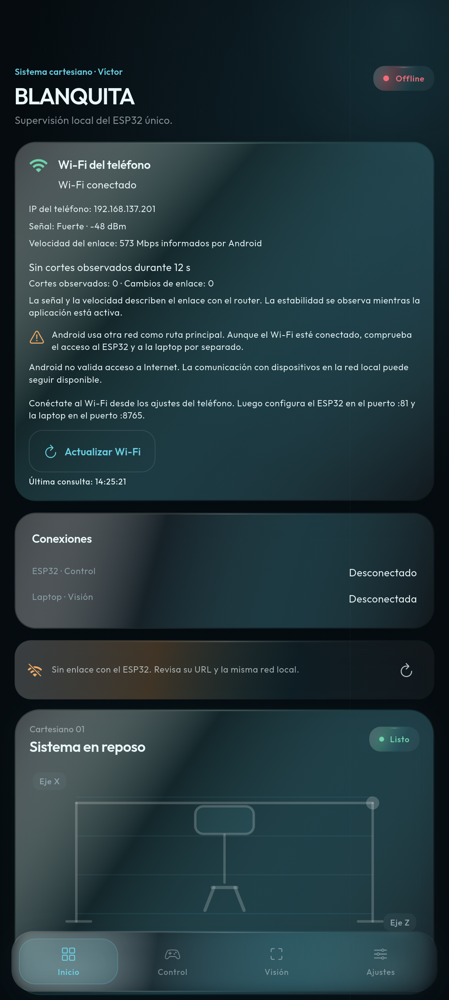
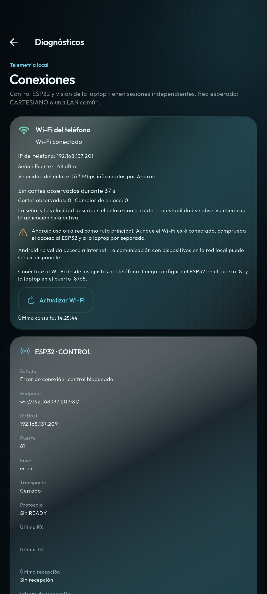

# Prueba real desde el teléfono — Wi-Fi observado, servidores no alcanzables

Fecha: 6 de octubre de 2026 (America/La_Paz). Aplicación BLANQUITA Víctor.

## Resultado actual: repetición con ESP32 encendido

Repetición del 6 de octubre de 2026, 14:25:08–14:25:45 (America/La_Paz), después de
que el usuario confirmó el ESP32 encendido y autorizó probar de nuevo la misma URL.
La lectura Wi-Fi funcionó; el alcance de ambos servidores volvió a fallar.

| Comprobación | Resultado actual |
| --- | --- |
| Teléfono / Wi-Fi | `192.168.137.201`, conectado, RSSI -48 dBm, enlace 573 Mbps |
| Continuidad observada | 36 s, 0 cortes y 0 cambios |
| Ruta predeterminada / Internet Wi-Fi | Ambos indicadores `false` |
| ESP32 WebSocket `192.168.137.209:81` | `CONNECT_TIMEOUT`, 5000 ms; transporte cerrado, sin READY |
| ESP32 TCP dirigido por Wi-Fi | `HOST_UNREACHABLE`, `EHOSTUNREACH`, 2326 ms |
| Laptop WebSocket `192.168.137.27:8765` | `CONNECT_TIMEOUT`, 8000 ms; transporte cerrado, sin vision.ready |
| Laptop TCP dirigido por Wi-Fi | `CONNECT_TIMEOUT`, `SocketTimeoutException`, 3008 ms |
| RX/TX de aplicación | Vacíos en ambos canales; ningún comando físico enviado |
| ICMP ESP32 por `wlan0` | 2 paquetes enviados, 0 recibidos, 2 errores de destino no alcanzable |
| Vecino ESP32 en `wlan0` | `192.168.137.209`: estado `FAILED` |

Errores originales de esta repetición:

```text
ESP32:
ConnectException: failed to connect to /192.168.137.209 (port 81)
from /192.168.137.201 (port 41136) after 3000ms:
isConnected failed: EHOSTUNREACH (No route to host)
elapsedMs=2326 route=wifi

Laptop:
SocketTimeoutException: failed to connect to /192.168.137.27 (port 8765)
from /192.168.137.201 (port 51564) after 3000ms
elapsedMs=3008 route=wifi
```

La repetición confirma un fallo de alcance desde el teléfono incluso cuando el
usuario informa que el ESP32 está encendido. No demuestra una causa concreta: se
deben contrastar la IP actual, pertenencia de los equipos a la misma LAN y posible
aislamiento/reglas del punto de acceso. La comprobación dirigida por Wi-Fi también
falló; el cambio de ruta predeterminada a Wi-Fi no basta como explicación o arreglo.
El resultado de laptop pasó de host no alcanzable en la primera ejecución a timeout
en esta repetición; ninguno confirma transporte ni protocolo.

La comprobación adicional del ESP32 con ICMP por `wlan0` tampoco alcanzó
`192.168.137.209`: 2 paquetes, 0 respuestas y 2 errores de destino no alcanzable.
La tabla de vecinos del teléfono mostraba esa dirección en `wlan0` como `FAILED`.
Esto refuerza el fallo de alcance LAN observado, sin probar por sí solo aislamiento,
IP cambiada u otra causa específica. Queda pendiente recibir el serial actual del
ESP32 después de encenderlo, con red e IP, para contrastarlo con la dirección probada.

Evidencia de la repetición:
[JSON con resultados](evidencias-conexiones/prueba-real-esp-encendido.json) y
[bitácora completa](evidencias-conexiones/prueba-real-esp-encendido.txt).
Las capturas siguientes corresponden a esta repetición: observación Wi-Fi y
Diagnósticos después de comprobar ambos endpoints.





## Primera ejecución, conservada como evidencia histórica

La lectura Wi-Fi funcionó en el teléfono. La apertura WebSocket falló en ambos
endpoints. Una segunda comprobación TCP, dirigida específicamente por la red
Wi-Fi de Android, también falló para los dos destinos con `EHOSTUNREACH`.
No se recibió `READY` ni `vision.ready`; no se enviaron comandos físicos.

| Comprobación | Resultado observado |
| --- | --- |
| Wi-Fi del teléfono | Conectado, IPv4 `192.168.137.201` |
| RSSI | `-48 dBm`, señal fuerte según escala de la app |
| Velocidad de enlace | `573 Mbps` informados por Android; no es throughput medido |
| Continuidad | 0 cortes y 0 cambios observados; 31 s en la lectura inicial y 36 s en la repetición |
| Ruta predeterminada Wi-Fi | `false`: Android seleccionó otra ruta predeterminada |
| Internet validado en Wi-Fi | `false`; no es un requisito para una LAN local |
| WebSocket ESP32 | `ws://192.168.137.209:81/`: `CONNECT_TIMEOUT`, 5000 ms, transporte cerrado |
| WebSocket laptop | `ws://192.168.137.27:8765/`: `CONNECT_TIMEOUT`, 8000 ms, transporte cerrado |
| TCP ESP32 por Wi-Fi explícito | `EHOSTUNREACH (No route to host)`, 2301 ms |
| TCP laptop por Wi-Fi explícito | `EHOSTUNREACH (No route to host)`, 2306 ms |
| RX/TX de aplicación | Vacíos en los dos canales de la prueba |

La prueba TCP utilizó `Android Network.socketFactory` de la conexión Wi-Fi para
abrir sólo el host/puerto configurado y cerrar el socket. No envió bytes de
aplicación ni validó el protocolo WebSocket. No cambió la ruta global del proceso
ni hizo escaneo de direcciones o puertos.

## Errores técnicos de la primera ejecución

ESP32:

```text
ConnectException: failed to connect to /192.168.137.209 (port 81)
from /192.168.137.201 (port 53672) after 3000ms:
isConnected failed: EHOSTUNREACH (No route to host)
elapsedMs=2301 route=wifi
```

Laptop:

```text
ConnectException: failed to connect to /192.168.137.27 (port 8765)
from /192.168.137.201 (port 33090) after 3000ms:
isConnected failed: EHOSTUNREACH (No route to host)
elapsedMs=2306 route=wifi
```

El primer JSON etiquetó esos errores como `TCP_ERROR`; el texto original ya
contenía `EHOSTUNREACH`. La clasificación posterior reconoce ese resultado como
`HOST_UNREACHABLE`. Esta mejora de etiqueta no altera el resultado físico de la
prueba ni convierte el fallo en una conexión exitosa.

La evidencia local original está en
[resultado JSON inicial](../.dart_tool/prueba-real-resultado-inicial.json) y
[bitácora inicial](../.dart_tool/prueba-real-bitacora.txt). Esos archivos generados
pueden no estar incluidos en el repositorio; este documento conserva los datos y
errores relevantes.

## Interpretación de la primera ejecución

El teléfono observó una asociación Wi-Fi con buena señal en esa ventana. Ambos
servidores seguían sin ser alcanzables: falló también la conexión TCP dirigida por
Wi-Fi. Por tanto, seleccionar datos móviles como ruta predeterminada no explica
por sí solo estos resultados y no justifica forzar una ruta global como arreglo.

El resultado no identifica cuál de estas posibles causas aplica: IP actual
distinta, equipo desconectado/apagado, equipos en redes distintas, aislamiento de
clientes del hotspot/router o reglas de red. Los endpoints deben contrastarse con
las IP actuales y la LAN de cada equipo. La señal del teléfono no verifica la
comunicación entre clientes ni que un servidor esté escuchando.

El ESP32 anunció por serial `ROLE:SENSORES` y “SISTEMA LISTO”. Ese mensaje serial
no sustituye `READY` por WebSocket ni demuestra soporte de comandos de control.
El servidor de laptop anunció bind `0.0.0.0:8765`; la prueba del móvil usó la IP
LAN aportada `192.168.137.27`, sin usar `0.0.0.0` como destino.

## Cómo repetirlo desde la app

En cada tarjeta de Diagnósticos, **Verificar puerto por Wi-Fi** abre una conexión
TCP al host/puerto de la URL configurada. El botón requiere una lectura Wi-Fi
conectada, un endpoint válido y que no haya otra comprobación activa. El resultado
aparece brevemente y queda en la bitácora `NETWORK`, con detalle técnico desplegable.

Esta verificación básica no envía movimientos, pinza, secuencia ni heartbeat físico.
Un éxito TCP todavía necesita una prueba WebSocket y el handshake `READY` o
`vision.ready`. Se mantienen las condiciones de seguridad de los controladores.

Después de confirmar desde cada equipo su IP y red actuales, repetir la prueba de
puerto y copiar la bitácora. No declarar control/visión operativos hasta tener
transporte abierto y confirmación de protocolo real. La validación de firmware,
visión y funcionamiento físico completo sigue pendiente.
